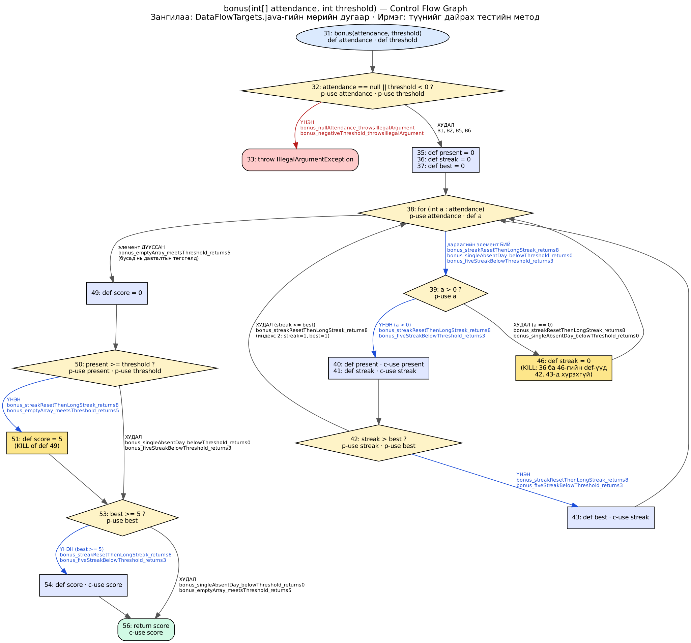

# Лаб 10: Өгөгдлийн урсгалын тест — Definition-Use хосууд

F.CSA313 — Программ хангамжийн чанарын баталгаа ба тест (2026)

**Оюутан:** Г. Нармандах | **Код:** B232270057

## 1. Орчин

`java -version`:

```
openjdk version "17.0.20.1" 2026-08-18
OpenJDK Runtime Environment Homebrew (build 17.0.20.1+0)
OpenJDK 64-Bit Server VM Homebrew (build 17.0.20.1+0, mixed mode, sharing)
```

`mvn -version`:

```
Apache Maven 3.9.16 (2bdd9fddda4b155ebf8000e807eb73fd829a51d5)
Maven home: /opt/homebrew/Cellar/maven/3.9.16/libexec
Java version: 17.0.20.1, vendor: Homebrew, runtime: /opt/homebrew/Cellar/openjdk@17/17.0.20.1/libexec/openjdk.jdk/Contents/Home
Default locale: en_MN, platform encoding: UTF-8
OS name: "mac os x", version: "26.6.2", arch: "aarch64", family: "mac"
```

| Зүйл | Утга |
|---|---|
| Хэрэгсэл | JUnit 5.10.2 (Jupiter), JaCoCo 0.8.12, Maven Surefire 3.2.5 |
| Компайлер | `maven.compiler.release` = 17 |
| Машин | MacBook Air (Apple Silicon, macOS 26.6.2) |

> Энэ машин дээр JDK 17 ба 27 хоёул суусан, Maven анхдагчаар 27-г сонгодог тул
> `~/.zshrc`-д `export JAVA_HOME=$(/usr/libexec/java_home -v 17)` гэж тогтоосон.

Бүх мөрийн дугаар нь `src/main/java/mn/edu/must/sqat/DataFlowTargets.java` **файлын**
мөрүүд. Лекц 10-д `gcd`-ийг 1–8 гэж дугаарласныг хөрвүүлсэн: 1→13, 3→15, 4→16, 5→17, 6→18, 8→20.

## 2. Хэсэг A: `gcd` — бүрэн DU хүснэгт

```
13: public static int gcd(int x, int y)   def x, def y
14:     int tmp;                           (зарлалт — def биш)
15:     while (y != 0)                     p-use y
16:         tmp = x % y;                   def tmp · c-use x · c-use y
17:         x = y;                         def x · c-use y
18:         y = tmp;                       def y · c-use tmp
20:     return x;                          c-use x
```

Нийт **11 DU хос**:

| # | Хувьсагч | Def | Use | Төрөл | Def-clear зам | Тест | Хамрагдсан |
|---|---|---|---|---|---|---|---|
| 1 | `x` | 13 | 16 | c-use | 13→15(Ү)→16 | A2, A3 | ✓ |
| 2 | `x` | 13 | 20 | c-use | 13→15(Х)→20 | **A1 (ганцаараа)** | ✓ |
| 3 | `x` | 17 | 16 | c-use | 17→18→15(Ү)→16 | A3 | ✓ |
| 4 | `x` | 17 | 20 | c-use | 17→18→15(Х)→20 | A2, A3 | ✓ |
| 5 | `y` | 13 | 15 | p-use (Ү ба Х) | 13→15 | A1 (Х), A2/A3 (Ү) | ✓ |
| 6 | `y` | 13 | 16 | c-use | 13→15(Ү)→16 | A2, A3 | ✓ |
| 7 | `y` | 13 | 17 | c-use | 13→15(Ү)→16→17 | A2, A3 | ✓ |
| 8 | `y` | 18 | 15 | p-use (Ү ба Х) | 18→15 | A2 (Х), A3 (Ү ба Х) | ✓ |
| 9 | `y` | 18 | 16 | c-use | 18→15(Ү)→16 | A3 | ✓ |
| 10 | `y` | 18 | 17 | c-use | 18→15(Ү)→16→17 | A3 | ✓ |
| 11 | `tmp` | 16 | 18 | c-use | 16→17→18 | A2, A3 | ✓ |

**Тестүүд ([GcdTest.java](src/test/java/mn/edu/must/sqat/GcdTest.java), 3 тест):**

- **A1 `gcd(7, 0)`** — давталтад огт ордоггүй цорын ганц тохиолдол. Зөвхөн энэ тест л **хос №2** (`def x(13) → c-use 20`)-ыг хамарна: өөр бүх оролтод мөр 17 нь `x`-ийг дахин тодорхойлж, 13-ын def-ийг алддаг. Мөн `y`-ийн p-use 15-ын **ХУДАЛ** салааг дайрна.
- **A2 `gcd(0, 5)`** — яг нэг эргэлт. 13-ын def-үүд давталтын биед хүрч (хос 1, 6, 7), 16 ба 17-ын def-үүд үүсч эхний use-дээ хүрнэ (хос 11, 4).
- **A3 `gcd(12, 8)`** — хоёр эргэлт (`tmp=4,x=8,y=4` → `tmp=0,x=4,y=0`). **Давталтаар дамжсан** хосууд (№3, 9, 10 ба №8-ын ҮНЭН салаа) зөвхөн хоёроос доошгүй эргэлттэй оролтод л хамрагдана — нэг эргэлтийн дараа давталт зогсвол 17, 18-ын def-үүд дахин use-д хүрэхгүй.

## 3. Хэсэг B: `bonus` — бүрэн анализ

### B1. CFG



Эх файл: [cfg-bonus.dot](cfg-bonus.dot) (Graphviz). Зангилаа бүр файлын мөрийн дугаартай,
ирмэг бүр дээр түүнийг дайрах тестийн бодит метод нэр бичигдсэн. `for-each` (мөр 38) нь
эхлүүлэлт/алхмаа илт бичдэггүй тул CFG-д: **нөхцөл** = `attendance`-д дараагийн элемент
байгаа эсэх (`attendance`-ийн p-use), **алхам** = дараагийн элементийг `a`-д оноох (`a`-ийн def).

### B2. Def / Use жагсаалт

```
31: bonus(int[] attendance, int threshold)      def attendance · def threshold
32: if (attendance == null || threshold < 0)    p-use attendance · p-use threshold
33:     throw IllegalArgumentException
35: int present = 0;                            def present
36: int streak = 0;                             def streak
37: int best = 0;                               def best
38: for (int a : attendance)                    p-use attendance · def a
39:     if (a > 0)                              p-use a
40:         present = present + 1;              def present · c-use present
41:         streak = streak + 1;                def streak · c-use streak
42:         if (streak > best)                  p-use streak · p-use best
43:             best = streak;                  def best · c-use streak
46:     else streak = 0;                        def streak        <- KILL
49: int score = 0;                              def score
50: if (present >= threshold)                   p-use present · p-use threshold
51:     score = 5;                              def score         <- KILL (49-ийг алдана)
53: if (best >= 5)                              p-use best
54:     score = score + 3;                      def score · c-use score
56: return score;                               c-use score
```

### B3. DU хүснэгт — 23 хос

| # | Хувьсагч | Def | Use | Төрөл | Тест (ID) |
|---|---|---|---|---|---|
| 1 | `attendance` | 31 | 32 | p-use Ү / Х | B3 (Ү) · B1,B2,B5,B6 (Х) |
| 2 | `attendance` | 31 | 38 | p-use Ү / Х | B1,B2,B6 (Ү) · B5 (Х) |
| 3 | `threshold` | 31 | 32 | p-use Ү / Х | B4 (Ү) · бусад (Х) |
| 4 | `threshold` | 31 | 50 | p-use Ү / Х | B1,B5 (Ү) · B2,B6 (Х) |
| 5 | `a` | 38 | 39 | p-use Ү / Х | B1,B6 (Ү) · B1,B2 (Х) |
| 6 | `present` | 35 | 40 | c-use | B1, B6 |
| 7 | `present` | 35 | 50 | p-use | **B2, B5 (зөвхөн)** |
| 8 | `present` | 40 | 40 | c-use | B1, B6 |
| 9 | `present` | 40 | 50 | p-use | B1, B6 |
| 10 | `streak` | 36 | 41 | c-use | B1, B6 |
| 11 | `streak` | 41 | 41 | c-use | B1, B6 |
| 12 | `streak` | 41 | 42 | p-use Ү / Х | B1,B6 (Ү) · B1 (Х) |
| 13 | `streak` | 41 | 43 | c-use | B1, B6 |
| 14 | `streak` | 46 | 41 | c-use | **B1 (зөвхөн)** |
| 15 | `best` | 37 | 42 | p-use | B1, B6 |
| 16 | `best` | 37 | 53 | p-use | **B2, B5 (зөвхөн)** |
| 17 | `best` | 43 | 42 | p-use | B1, B6 |
| 18 | `best` | 43 | 53 | p-use Ү / Х | B1,B6 (Ү) · B1 (Х) |
| 19 | `score` | 49 | 54 | c-use | **B6 (зөвхөн)** |
| 20 | `score` | 49 | 56 | c-use | **B2 (зөвхөн)** |
| 21 | `score` | 51 | 54 | c-use | B1 |
| 22 | `score` | 51 | 56 | c-use | B5 |
| 23 | `score` | 54 | 56 | c-use | B1, B6 |

### B3 (үргэлжлэл). Kill-ээр тасарсан хослолууд — DU хос БИШ

| Def | Use | Яагаад DU хос биш |
|---|---|---|
| `streak` 36 | 42 (p-use) | Мөр 41 (`streak = streak + 1`) нь `a > 0` салаа дотор 42-оос **өмнө** байрлаж, 36-ийн def-ийг үргэлж алдана. Def-clear зам байхгүй. |
| `streak` 36 | 43 (c-use) | Мөн адил — 43-д хүрэхийн тулд 41-ийг заавал дайрна. |
| `streak` 46 | 42 (p-use) | 46-гийн дараа 42-д хүрэх цорын ганц зам нь давталтын дараагийн эргэлтийн `a > 0` салаа бөгөөд тэнд мөр 41 дахин тодорхойлно. |
| `streak` 46 | 43 (c-use) | Мөн адил. |

Дүгнэлт: **`streak`-ийн 42, 43 дээрх use-үүдэд зөвхөн мөр 41-ийн def л хүрч чадна.**
`streak`-ийн гурван def байгаа ч (36, 41, 46) эхний ба гурав дахь нь ганцхан use-тай
(`c-use 41`) — энэ бол kill-ийн шууд үр дагавар.

**p-use-ийн салаануудын тухай:** хүснэгтэд p-use бүрийг ҮНЭН/ХУДАЛ салаагаар нь тусад нь
тоолсон. Мөр 42-ын ХУДАЛ салаа (`streak <= best`) зөвхөн **завсрын дараа** боломжтой:
тасралтгүй цувааны үед `streak` нь `best`-ээс үргэлж 1-ээр их байдаг тул нөхцөл үргэлж үнэн.
B1-ийн `[1,0,1,…]`-ийн индекс 2 дээр `streak=1, best=1` болж энэ салаа дайрагдана.

### B4. Хоёр шатны тестүүд

**1-р шат — ALL-DEFS: 2 тест** ([commit `c8f2863`](../../commit/c8f2863)).
`bonus`-д 13 def бий: `attendance`(31), `threshold`(31), `a`(38), `present`(35, 40),
`streak`(36, 41, 46), `best`(37, 43), `score`(49, 51, 54).

Хоёроос цөөн болохгүй шалтгаан: **`score`-ийн def 49 ба 51 хоёр нэг гүйцэтгэлд
хоёулаа use-д хүрч чадахгүй.** Мөр 50 ҮНЭН бол def 51 нь def 49-ийг алдаж (49 ямар ч
use-д хүрэхгүй), ХУДАЛ бол def 51 огт үүсэхгүй. Тиймээс мөр 50-ийн үнэн ба худал хоёр
тусдаа гүйцэтгэл заавал шаардлагатай — B1 (50 ҮНЭН) ба B2 (50 ХУДАЛ).

**2-р шат — ALL-DU-PAIRS: 6 тест** ([commit `8f39449`](../../commit/8f39449)).
B3–B6 нэмэгдэж 23 хос бүгд хамрагдана:

| Тест | Оролт | Хариу | Ямар хосыг ганцаараа барьдаг |
|---|---|---|---|
| B1 | `[1,0,1,1,1,1,1]`, thr=2 | 8 | №14 (`46→41`) — завсар дараа нь цуваа |
| B2 | `[0]`, thr=1 | 0 | №20 (`49→56`) |
| B3 | `null`, thr=0 | throw | №1-ийн ҮНЭН салаа |
| B4 | `[1]`, thr=−1 | throw | №3-ийн ҮНЭН салаа |
| B5 | `[]`, thr=0 | 5 | №2-ийн ХУДАЛ салаа, №22 |
| B6 | `[1,1,1,1,1]`, thr=10 | 3 | №19 (`49→54`) |

№7 (`present 35→50`) ба №16 (`best 37→53`) хоёрыг зөвхөн **давталтын бие `a > 0` салаанд
огт ордоггүй** оролт (B2, B5) барина — өөр тохиолдолд 40 ба 43 нь эхний def-үүдийг алдана.

### B5. JaCoCo — branch ба DU хоёрын хамаарал

| Шат | Тест | Instruction | Branch | Line | Файл |
|---|---|---|---|---|---|
| All-defs | 5 | 73 / 81 | **14 / 16** | 22 / 24 | [jacoco-alldefs.csv](results/jacoco-alldefs.csv) |
| All-DU-pairs | 9 | 78 / 81 | **16 / 16** | 23 / 24 | [jacoco-alldu.csv](results/jacoco-alldu.csv) |
| Эцсийн (+M2 kill) | 10 | 78 / 81 | **16 / 16** | 23 / 24 | [jacoco-final.csv](results/jacoco-final.csv) |

`LINE_MISSED = 1` нь мөр 7 — Java-гийн далд constructor (`DataFlowTargets()`); багш үүнийг
зөвшөөрсөн тул хамруулах тест бичээгүй.

**All-defs хангагдсан ч branch 100% биш байж болох уу? — ТИЙМ, хэмжигдсэн.**
All-defs шатанд `BRANCH_MISSED = 2` байв. Алга болсон хоёр салаа нь мөр 32-ын
`attendance == null` ба `threshold < 0` хоёрын **ҮНЭН** утгууд. Шалтгаан нь энгийн:
`attendance` ба `threshold`-ийн def-үүд 32-ын **ХУДАЛ** салаагаар аль хэдийн use-д хүрсэн
тул all-defs шалгуур хангагдсан — exception-ы зам руу орох тест all-defs-д огт шаардлагагүй.

**Branch 100% болсон мөчид DU хос дутаж болох уу? — ТИЙМ.**
Жишээ: `{bonus(null,0), bonus([1],−1), bonus([1,0,1],5), bonus([1,1,1,1,1],2)}` гэсэн
дөрвөн тест 16/16 салааг бүрэн хамарна (32: Ү/Ү/Х/Х; 38: Ү ба Х; 39: Ү ба Х; 42: Ү ба Х —
`[1,0,1]`-ийн индекс 2; 50: Х ба Ү; 53: Х ба Ү). Гэсэн хэдий ч хос **№7** (`present 35→50`)
ба **№16** (`best 37→53`) хоёр хамрагдахгүй: тэдгээр нь `present` болон `best` **дахин
тодорхойлогдоогүй** гүйцэтгэл шаарддаг, өөрөөр хэлбэл `a > 0` салаа огт дайрагдаагүй
оролт (хоосон массив эсвэл бүх өдөр тасалсан) хэрэгтэй. Дээрх дөрвөн тестийн алинд нь ч
тийм оролт байхгүй. Энэ бол лекцийн гол баталгаа: **branch хамралт DU хамралтыг агуулдаггүй.**

## 4. Хэсэг C: Fault seeding

Гурван мутацийг [`seed-faults.sh`](seed-faults.sh) скриптээр нэг нэгээр нь тарьж,
`mvn test` ажиллуулж, тус бүрийн дараа `git restore`-оор буцаасан.

| № | Мутаци | Үр дүн | Унасан тест |
|---|---|---|---|
| **M1** | мөр 41 `streak = streak + 1;` устгав | `Tests run: 9, Failures: 2` · BUILD FAILURE | `bonus_fiveStreakBelowThreshold_returns3:72` — `expected: <3> but was: <0>`<br>`bonus_streakResetThenLongStreak_returns8:30` — `expected: <8> but was: <5>` |
| **M2** | мөр 43 `best = streak;` → `best = present;` | `Tests run: 9, Failures: 0` · **BUILD SUCCESS — АМЬД** | — |
| **M3** | давталтын дараа `int total = present + best;` нэмэв | `Tests run: 9, Failures: 0` · **BUILD SUCCESS — АМЬД** | — |

→ [mvn-test-M1.txt](results/mvn-test-M1.txt) · [mvn-test-M2.txt](results/mvn-test-M2.txt) · [mvn-test-M3.txt](results/mvn-test-M3.txt)

### M2 яагаад 23 хос бүгд хамрагдсан атал амьд үлдсэн бэ

DU хамралт нь **def-ээс use хүртэлх зам дайрагдсан эсэхийг** шалгадаг болохоос тэр замаар
дамжсан **утга зөв эсэхийг** шалгадаггүй. M2 нь мөр 43-ын def-ийг хэвээр үлдээж (хос №17,
№18 аль аль нь дайрагдсаар), зөвхөн оноогдох **утгын эх сурвалжийг** `streak`-ээс `present`
рүү сольсон. Тиймээс хүснэгтийн бүх мөр ногоон хэвээр байна.

Яагаад миний 6 тест ялгааг мэдрээгүй вэ: `best` нь зөвхөн `streak > best` үед шинэчлэгддэг.
Тасралтгүй цувааны үед `present` ба `streak` хоёр **ижил** өсдөг тул B6 (`[1,1,1,1,1]`)-д
хоёр хувилбар ижил `best = 5` өгнө. Харин B1 (`[1,0,1,1,1,1,1]`)-д завсар байгаа ч эцсийн
цуваа 5 хүрч `best = 5` болсон тул мөн ижил хариу гарсан — өөрөөр хэлбэл хоёр оролт хоёулаа
«`best >= 5` ҮНЭН» гэсэн нэг талд унасан.

**Унагасан тест:** `bonus_gapThenFourStreak_doesNotReachBonus` — `bonus([1,0,1,1,1,1], 5)`.
Энд `present = 5` боловч хамгийн урт **дараалсан** цуваа нь 4: эх код `best = 4 < 5` тул
урамшуулалгүй **5** буцаана, M2 харин `best`-ийг ирсэн өдрийн тоогоор өсгөж `5` хүргэснээр
**8** буцаана. Энэ тест нь `present` ба `streak` хоёрын тэнцвэрийг зориуд эвдэж, M2-ын
«буруу хувьсагчийн use»-ийг гадагш гаргадаг.

```
Tests run: 10, Failures: 1
BonusTest.bonus_gapThenFourStreak_doesNotReachBonus:88 expected: <5> but was: <8>
```

→ [mvn-test-M2-kill.txt](results/mvn-test-M2-kill.txt)

Анзаарах зүйл: энэ тест **хамралтын ямар ч тоог нэмээгүй** — `jacoco-alldu.csv` ба
`jacoco-final.csv` хоёр яг ижил (Branch 16/16, Line 23/24), DU хүснэгтэд ч шинэ хос нэмэгдээгүй.
Гэсэн ч бодит согог барив.

### M3 — яагаад нэг ч тест унагаагүй вэ

`int total = present + best;` гэсэн def-ийн утга **хаана ч уншигдахгүй** (use байхгүй), тиймээс
функцийн гаралтад огт нөлөөлөхгүй. Ямар ч динамик тест зөвхөн ажиглагдах зан төлөвийг
шалгадаг тул үхсэн def-ийг **зарчмын хувьд** барьж чадахгүй — энэ бол тестийн сул тал биш,
динамик аргын хил хязгаар. DU анализын хэлээр: `total` нь **def-use хосгүй def** —
өөрөөр хэлбэл DU хүснэгтэд огт мөр үүсгэхгүй, яг энэ нь дохио юм.

**Ямар багаж барих ёстой вэ — статик анализ.** `javac` үүнийг анхааруулдаггүй
(локал хувьсагч ашиглагдаагүй байх нь компайлын алдаа биш), VS Code-ын Java
өргөтгөл ч анхдагч тохиргоогоороо энэ мөрийг тэмдэглээгүй — M3-ийг тарьсан үед
редактор дээр ямар ч шар зураас гарсангүй. Харин **PMD**-г ажиллуулахад шууд барив:

```
mvn org.apache.maven.plugins:maven-pmd-plugin:3.21.2:pmd \
    -Dformat=txt -Drulesets=category/java/bestpractices.xml
```

```
/Users/narmandah/Uni/F.CSA313-lab10/src/main/java/mn/edu/must/sqat/DataFlowTargets.java:49:
	UnusedLocalVariable:	Avoid unused local variables such as 'total'.
```

→ [results/pmd-M3.txt](results/pmd-M3.txt)

Өөрөөр хэлбэл үхсэн def-ийг барих багаж **байдаг** (PMD-гийн `UnusedLocalVariable`,
SpotBugs-ийн `DLS_DEAD_LOCAL_STORE`, ErrorProne), гэхдээ тэдгээр нь ердийн build-д
**анхдагчаар ордоггүй** — зориуд асаах шаардлагатай. M3 нь тестийн багцын сул талыг биш,
**тестлэх аргын өөрийнх нь хил хязгаарыг** харуулж байгаа учраас шийдэл нь нэмэлт тест биш,
өөр ангиллын багаж юм.

## 5. Дүгнэлт

Өгөгдлийн урсгалын анализ branch хамралтаас илүү зүйл нь тодорхой хэмжигдлээ: all-defs
хангагдсан үед branch 14/16 байсан, өөрөөр хэлбэл хоёр шалгуур бие биенээ агуулдаггүй, мөн
branch 16/16 болсон хэдэн ч тестийн багц DU хос дутаалгүй гэсэн баталгаа өгдөггүй (B5-д
жишээгээр үзүүлсэн). DU шалгуурын давуу тал нь хувьсагчийн утга **хаанаас гарч хаана
хэрэглэгдэж байгааг** шалгадагт оршино — `streak`-ийн гурван def-ээс хоёр нь ганцхан use-тай
байдаг (kill-ийн улмаас) гэдэг мэдээллийг branch хамралт хэзээ ч өгөхгүй. Үнэтэй тал нь
гараар хийгддэг: JaCoCo DU хамралтыг **огт хэмждэггүй** тул 23 хосын хүснэгт, def-clear
замууд, kill-ийн шинжилгээг бүгдийг гараар хийж, тест бүрийг хосуудад буулгах шаардлагатай
болсон — энэ лабын цагийн 60 орчим хувийг Хэсэг B3 (DU хүснэгт ба kill-ийн үндэслэл) авав.
Хамгийн сургамжтай нь Хэсэг C байлаа: 23 хос бүгд хамрагдсан, branch 16/16 байсан атал M2
амьд үлдсэн нь **хамралтын шалгуур бол замыг л шалгадаг, утгыг шалгадаггүй** гэдгийг
шууд харуулав. Түүнийг унагасан тест хамралтын нэг ч тоог нэмээгүй — өөрөөр хэлбэл сайн
тест заавал шинэ хамралт авчирдаггүй, харин **oracle-ийн хувьд ялгаатай** байх ёстой.
Эцэст нь M3 нь динамик тестийн зарчмын хилийг зурж өгөв: гаралтад нөлөөлөхгүй кодыг зөвхөн
статик анализ л барина.

## 6. AI ашиглалтын тэмдэглэл

Энэ лабораторид AI туслахыг (Claude) DU хосуудын анализ, тестийн классуудын төсөл,
`seed-faults.sh` ба `kill-m2.sh` скриптүүд, CFG-ийн Graphviz эх файл, тайланг
хэлбэржүүлэхэд ашигласан. Бүх `mvn` ажиллуулалтыг өөрийн MacBook дээр (JDK 17.0.20.1,
Maven 3.9.16) хийж, `results/` доторх есөн файл бүр тэр ажиллуулалтаас үүссэн;
README-д бичигдсэн тоо, унасан тестийн нэр, `expected/was` мөр бүр тэдгээр файлаас шууд
авагдсан — таамаглаж бичсэн зүйл байхгүй. CFG-г Graphviz-ээр үүсгэсэн (даалгавар
draw.io/Excalidraw зэрэг хэрэгсэл ашиглахыг зөвшөөрсөн) бөгөөд ирмэг бүрийн тестийн нэрийг
тестийн файлтай тулган шалгасан.

## 7. Нэмэлт даалгавар: AI-гийн DU хүснэгттэй харьцуулалт

B3-аа дуусгасны дараа `bonus()`-ийн кодыг мөрийн дугаарын хамт Google Gemini-д өгч
«бүх DU хосын хүснэгтийг гарга, def-clear зам байхгүй хослолыг тусад нь жагсаа» гэж хүсэв.

**(1) Ямар хос алдав, юуг илүү нэмэв — алийг нь ч үгүй.** AI мөн **23** def-clear хостой
гэж гаргасан бөгөөд жагсаалтыг нь миний хүснэгттэй мөр мөрөөр тулгахад **бүрэн ижил**
байв: `attendance` 2, `threshold` 2, `a` 1, `present` 4, `streak` 5, `best` 4, `score` 5.
Нэмэлт хос ч зохиогоогүй, дутаасан ч хос алга — энэ нь миний гараар хийсэн анализын
бие даасан баталгаа болов.

**(2) Def-clear зам ба kill дээр алдаа гаргав уу — үгүй.** AI мөн яг тэр **4** хослолыг
(`streak` 36→42, 36→43, 46→42, 46→43) def-clear замгүй гэж зөв тогтоож, шалтгааныг нь ч
зөв тайлбарлав: 42, 43-д хүрэхийн тулд мөр 41-ээр заавал дамждаг тул 36 ба 46-гийн
def-үүд үргэлж kill хийгдэнэ. Kill-ийн шинжилгээ бол энэ функцийн хамгийн нарийн хэсэг
байсан бөгөөд AI түүнийг бүрэн зөв хийлээ.

**(3) Зөрүү хоёр газар гарсан — хоёулаа AI-гийн алдаа.** Нэгдүгээрт, AI
`attendance`-ийн 31→38 хосыг **c-use** гэж ангилсан бол би **p-use** гэсэн. Даалгаврын
B1 заавар үүнийг шууд шийддэг: *«нөхцөл = attendance-д дараагийн элемент байгаа эсэх
(attendance-ийн p-use)»* — `for-each` давталтын толгой нь `attendance`-ийг үргэлжлүүлэх
эсэхийг **шийдэхэд** ашигладаг тул predicate use мөн. Хоёрдугаарт, AI-гийн p-use-ийн
True/False хүснэгтэд мөр 42-ын ХУДАЛ зам «45 (if-ээс гарах)» гэж бичигдсэн нь буруу —
мөр 45 бол мөр **39**-ийн `else`, харин 42-ын худал зам нь дотоод `if`-ээс гарч давталтын
дараагийн эргэлт рүү (мөр 48 → 38) очно.

**Дүгнэлт.** Бүтцийн анализ буюу «аль def аль use-д хүрэх вэ, хаана kill болох вэ» гэсэн
механик хэсгийг AI бүрэн зөв хийж чадсан нь энэ ажлын тэр хэсэг албан ёсны дүрмээр
тодорхойлогддогтой нийцэж байна. Харин **тодорхойлолтын нарийн ялгаа** (`for-each`-ийн
толгой нь c-use үү p-use уу) болон **CFG-ийн бодит бүтэц** (аль мөр рүү салаа буцах вэ)
дээр алдсан — эдгээр нь тухайн курсын тодорхойлолт ба кодын бодит удирдлагын урсгалыг
мэдэхийг шаарддаг. Мөн AI хос бүрд **ямар тест** хариуцахыг огт зааж өгөөгүй (би түүнийг
асуугаагүй ч) — тест дизайн нь энэ лабын бодит ажил бөгөөд хүснэгт гаргах нь түүний
зөвхөн бэлтгэл шат юм. Тиймээс AI-гийн гаралтыг **хяналтын хуулбар** болгон ашиглах нь
үнэ цэнэтэй, харин тестийн багцыг орлуулах чадваргүй байна.
